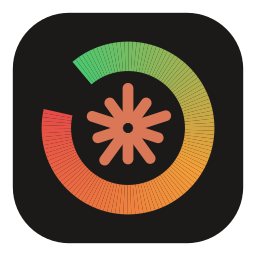
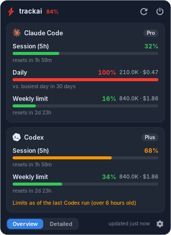
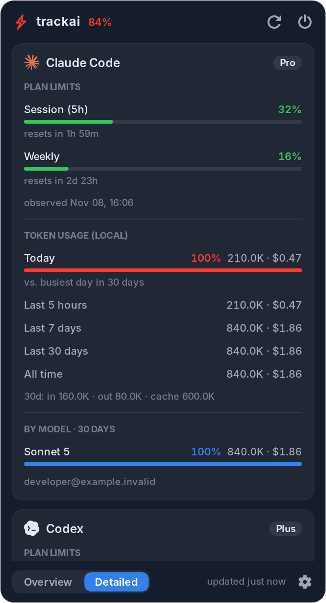
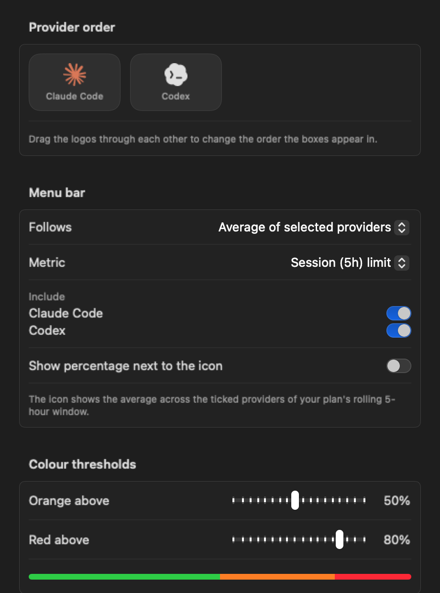

<p align="center">
  
</p>

<h1 align="center">trackai</h1>

<p align="center">
  
  
  
  
  
</p>

<p align="center">
  <b>Claude Code and Codex usage in your menu bar.</b><br>
  See how much of your session and weekly limits you have left, on macOS or Linux. Nothing to paste, no account to create.
</p>

<p align="center">
  
  
</p>

## Table of contents

- [Features](#features)
- [Requirements](#requirements)
- [Install](#install)
- [Set up](#set-up)
- [Use](#use)
- [Commands](#commands)
- [Troubleshooting](#troubleshooting)
- [Privacy](#privacy)
- [License](#license)

> Building from source or contributing? See [CONTRIBUTING.md](CONTRIBUTING.md).

## Features

- **Both tools in one panel.** Claude Code and Codex side by side, with each plan's 5-hour and weekly limits and when they reset.
- **Read it at a glance.** The menu bar icon fills up and turns green, orange, then red as you use your limits. Follow a single provider and it shows that provider's logo instead.
- **Overview or detail.** **Overview** shows your limits. **Detailed** adds token counts, estimated cost, and a per-model breakdown.
- **Nothing to set up.** trackai reads the logins Claude Code and Codex already keep on your computer.
- **Fits your desktop.** On Linux it follows your theme's colours and opens right under the tray icon, including in tiling window managers like i3.

<p align="center">
  <br>
  <sub>Choose what the icon follows and when it turns orange or red.</sub>
</p>

## Requirements

- **macOS 13** or later (Apple Silicon or Intel), or **Linux** with a system tray (Ubuntu 22.04 or later; tested on 24.04)
- **Claude Code** and/or **Codex**, logged in on this computer

## Install

```sh
curl -fsSL https://raw.githubusercontent.com/sjcsoftware/trackai/main/install.sh | bash
```

The same command works on macOS and Linux. On Linux it may ask for your password to install a few system packages.

To update later:

```sh
trackai update
```

## Set up

1. If you haven't yet, run `claude` and/or `codex` in a terminal and log in.
2. Run `trackai setup`. It finds your logins and starts the app.
3. Click the trackai icon in your menu bar or system tray.

> **GNOME:** Ubuntu shows tray icons out of the box. On other GNOME desktops, install `gnome-shell-extension-appindicator`, then log out and back in.

## Use

| Do this | To |
| --- | --- |
| Click the icon | Open the panel |
| Click **Overview** / **Detailed** | Switch between limits and the full breakdown |
| Click ⟳ | Refresh now |
| Click ⚙ | Open Settings |
| Click anywhere else (or press <kbd>Esc</kbd> on Linux) | Close the panel |

In **Settings** you can:

- turn Claude Code or Codex on and off, and change their order
- choose what the icon follows: the session, weekly, or daily usage of one provider, or the average or highest across them
- set when the icon turns orange and red (50% and 80% by default)
- adjust the panel's transparency, the refresh interval, and launch at login
- add a second Claude account by pointing trackai at its config folder

## Commands

| Command | Does |
| --- | --- |
| `trackai setup` | Find your logins and start the app |
| `trackai start` / `stop` / `restart` | Control the app |
| `trackai status` | Check whether it is running |
| `trackai update` | Install the latest version and restart |
| `trackai stats` | Print your usage as JSON (works over SSH) |
| `trackai logs` | Show recent log output |
| `trackai uninstall` | Remove trackai and keep your settings |

## Troubleshooting

- **No icon on GNOME.** Install `gnome-shell-extension-appindicator`, then log out and back in.
- **`trackai: command not found`.** Add `~/.local/bin` to your `PATH`, or use the full path the installer printed.
- **Claude shows "login expired".** Run `claude` in a terminal and log in again. Codex keeps working on its own.
- **Codex limits look old.** They update the next time you use Codex. The panel shows when they were last seen.
- **Anything else.** Run `trackai logs` and [open an issue](https://github.com/sjcsoftware/trackai/issues).

## Privacy

- trackai reads Claude Code's and Codex's files on your computer and never uploads them.
- Its only network request is Claude's read-only usage check, at most every five minutes. Codex makes none.
- Costs are estimates at API prices. Subscriptions are not billed per token.

## License

MIT © 2026 Cha Seungjoon. See [LICENSE](LICENSE).
