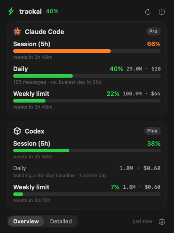
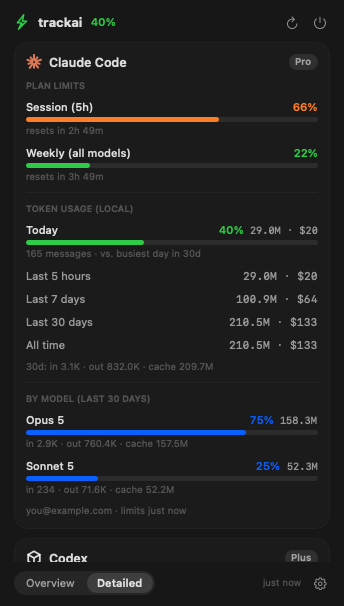

# trackai

Claude Code and Codex usage in your Mac menu bar — one bolt, one panel, per-provider boxes.

<p align="center">
  
  
</p>

macOS only. Native Swift + SwiftUI, no runtime, no daemon, no token to paste.

## Install

```sh
curl -fsSL https://raw.githubusercontent.com/sjcsoftware/trackai/main/install.sh | bash
trackai setup
```

`trackai setup` reads the logins the CLIs already keep on this Mac. If neither
tool is set up yet, run `claude` and/or `codex` in a terminal first, then run
setup again.

## What it shows

Click the menu bar icon and you get one rounded box per provider, its logo in
the top-left corner. Two pages, switched from the bar at the bottom:

**Overview** — three bars per provider, in the order the windows tighten:

- **Session (5h)** — the rolling five-hour window your plan enforces, with its
  reset time. Claude reports it over the API; Codex records it in its own logs.
- **Daily** — today's tokens against your busiest day in the last 30, with the
  token count and estimated cost. Until there are three days of history to
  compare against, it shows today's raw total instead of a meaningless 100%.
- **Weekly** — your plan's weekly window when the provider reports one
  (Claude's weekly limit, Codex's 7-day rate limit), otherwise your local
  7-day usage against your busiest week.

**Detailed** — everything, per provider:

- Every plan window the provider reports, with its reset time
  (Claude: session 5h + weekly all/Opus/Sonnet; Codex: 5h + weekly)
- Local token usage for today, the last 5 hours, 7 days, 30 days and all time,
  each with an estimated cost
- Input / output / cache split for the last 30 days
- A per-model breakdown, sized by share of the last 30 days
- The account email, plan and how fresh the limit data is

## Settings

The gear at the bottom right:

1. **Provider order** — drag the logos through each other to reorder the boxes.
2. **Menu bar** — pick what the icon follows: the average of the ticked
   providers, whichever is highest, or a single provider; and whether that uses
   daily, weekly or session usage. Optionally show the percentage next to the icon.
   Averaging several providers draws a bolt that fills as usage climbs; picking a
   single provider draws that provider's own mark. Either way it takes the
   green/orange/red colour from your thresholds.
3. **Colour thresholds** — two matched sliders for where the icon turns orange
   and red (50% and 80% by default). Red stops when it reaches orange, so the
   three bands always stay in order.
4. **Providers** — enable or disable each one, and point trackai at extra
   `CLAUDE_CONFIG_DIR` paths or a non-default `CODEX_HOME`. One provider is
   enough; the app works with whatever you have.
5. **Appearance** — transparency intensity, or a fully opaque background.
6. **General** — launch at login, refresh interval, manual refresh, quit.

## Where the numbers come from

Nothing is scraped from a browser and nothing is typed in by hand.

| | Claude Code | Codex |
|---|---|---|
| Login | `~/.claude/.credentials.json`, else the `Claude Code-credentials` Keychain item | `~/.codex/auth.json` (the ChatGPT `id_token` carries the email and plan) |
| Tokens | `~/.claude/projects/**/*.jsonl` assistant records | `~/.codex/sessions/**/*.jsonl` `token_usage_record` entries, falling back to `token_count` events on older CLIs |
| Plan limits | Anthropic's OAuth usage endpoint | the `rate_limits` block Codex writes into its own rollout log |

Claude's limits come over the network, so they are polled at most every five
minutes, cached across restarts and backed off exponentially on HTTP 429.
Codex needs no network call at all — the CLI records its rate limits after every
response, so trackai reports exactly what Codex last saw. That snapshot only
advances when Codex runs, and the panel says so once it is more than six hours old.

Costs are estimates computed from published per-million rates. On a Claude or
ChatGPT subscription you are not billed per token, so treat them as "what this
traffic would have cost on the API" — Codex costs are labelled `est.` for that reason.

## Commands

```
trackai setup       Connect to your existing CLI logins and start the app
trackai start       Start the app
trackai stop        Quit the app
trackai restart     Restart the app
trackai status      Report whether the app is running
trackai update      Update to the latest version and restart
trackai stats       Print all usage stats as JSON
trackai uninstall   Remove the app and this CLI
```

## Building from source

```sh
git clone https://github.com/sjcsoftware/trackai
cd trackai
./scripts/build.sh
./trackai            # the menu bar app, straight out of the repo root
```

`scripts/build.sh` produces a universal (arm64 + x86_64) binary, assembles
`dist/TrackAI.app`, zips it to `dist/TrackAI.zip` for the installer, and drops a
testable `./trackai` in the repo root. Requires the Xcode Command Line Tools.

`./trackai --render out.png [--detailed|--settings]` renders a page offscreen,
which is how the screenshots above are generated.

## Adding a provider

Providers are pluggable: conform to `UsageProvider` in
`Sources/trackai/Providers/`, add a case to `ProviderKind`, draw a mark in
`ProviderMark`, and register it in `ProviderRegistry.all`. Everything else —
ordering, enabling, the menu bar maths, both pages — picks it up automatically.

## Licence

MIT © 2026 Cha Seungjoon
