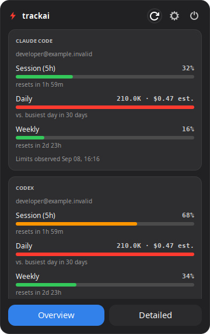

# trackai

Claude Code and Codex usage in your macOS menu bar or Linux system tray — one bolt, one panel, per-provider boxes. No credentials to copy or paste.

<p align="center">
  
  
</p>

Native Swift + SwiftUI on macOS; Python + GTK 3 on Linux, adapted from [trackclaude](https://github.com/sjcsoftware/trackclaude). Linux support is verified on Ubuntu 24.04 and designed for Ubuntu 22.04+ and Debian derivatives.

## Install

**The same command works on macOS and Linux.** The script detects the operating system and downloads the matching payload from `main`. Users do not need to select a branch, architecture, or build anything.

```sh
curl -fsSL https://raw.githubusercontent.com/sjcsoftware/trackai/main/install.sh | bash
trackai setup
```

Setup reads the logins the CLIs already keep on this machine. If neither tool is set up yet, run `claude` and/or `codex` in a terminal, log in, then run setup again. One provider is enough. TrackAI never refreshes, rewrites, or asks you to paste a credential.

### macOS

Requires macOS 13+. The installer downloads the prebuilt universal app for Apple Silicon and Intel, installs `/Applications/TrackAI.app`, and installs the CLI in a writable `/opt/homebrew/bin`, `/usr/local/bin`, or `~/.local/bin`.

### Linux (Ubuntu)

Requires Python 3.8+ and a graphical desktop for the tray. Nothing is compiled. The installer uses the system Python (`/usr/bin/python3`) and installs missing Ubuntu/Debian packages with `apt`:

- `python3`, `python3-gi`, `python3-gi-cairo`, `python3-cairo`
- `gir1.2-gtk-3.0`
- `gir1.2-ayatanaappindicator3-0.1` (or the older AppIndicator binding)

Only installing missing system packages requires sudo. Run the installer as your normal desktop user. The app, launcher, and preferences live in your home directory:

| Path | Contents |
|---|---|
| `~/.local/share/trackai/` | Python application |
| `~/.local/bin/trackai` | Linux CLI |
| `~/.local/share/applications/trackai.desktop` | Desktop launcher |
| `~/.config/trackai/settings.json` | Preferences |
| `~/.cache/trackai/` | Limit cache, icons, PID, and log |
| `~/.config/autostart/trackai.desktop` | Optional launch-at-login entry |

The standard `XDG_DATA_HOME`, `XDG_CONFIG_HOME`, and `XDG_CACHE_HOME` overrides are respected. If `~/.local/bin` is missing from your shell's PATH, add `export PATH="$HOME/.local/bin:$PATH"` to your shell configuration, or use the full CLI path printed by the installer.

Ubuntu's GNOME desktop normally includes AppIndicator support. If the app runs but no tray icon appears, enable the Ubuntu AppIndicators extension. On stock GNOME, install `gnome-shell-extension-appindicator`, then log out and back in. Open the panel from the tray menu, or middle-click the icon. Classic X11 trays support direct left-click through a fallback icon.

On other distributions, the installer checks the same bindings and prints equivalent Fedora/Arch package commands if they are missing. Those distributions are not yet verified. `trackai stats` runs without GTK or a display, including over SSH.

## What it shows

**Overview** shows one box per provider:

- **Session** — the plan's rolling limit and reset time, when available.
- **Daily** — today's tokens and estimated cost, relative to the busiest day in the last 30. A percentage appears only after at least three active days provide a baseline.
- **Weekly** — the provider's weekly plan limit, or local seven-day usage relative to the busiest recent week when no plan limit is available.

**Detailed** shows every reported plan window, local token totals for today / five hours / seven days / 30 days / all time, a 30-day input/output/cache split and model breakdown, and the account, plan, and observation time.

Linux also shows live summaries in the tray menu. Additional Claude config directories appear as separate account boxes on Linux.

## Settings

Use the gear in the panel or **Settings…** in the Linux tray menu:

- Enable providers, change their order, add Claude config directories, and override `CODEX_HOME`.
- Choose daily, session, or weekly usage for the icon; combine selected providers by average or highest usage, or select one account/provider.
- Show the percentage next to the icon; adjust the orange/red thresholds (50% / 80% by default).
- Adjust transparency, select an opaque background, set the refresh interval, and enable launch at login.

On macOS, drag provider logos to reorder them; Linux uses up/down buttons. The Mac menu bar can show a provider glyph or a filling bolt; Linux uses a colored bolt. macOS has native background blur; Linux uses a translucent window. GNOME's tray protocol opens a menu before the custom panel.

## Where the numbers come from

| | Claude Code | Codex |
|---|---|---|
| Login | `~/.claude/.credentials.json`, with read-only Keychain fallback on macOS or `secret-tool` on Linux | `~/.codex/auth.json`; JWT claims carry the account and plan |
| Tokens | `~/.claude/projects/**/*.jsonl` assistant records | `~/.codex/sessions/**/*.jsonl`; new `token_usage_record` entries or older `token_count` deltas |
| Plan limits | Anthropic's OAuth usage endpoint | `rate_limits` snapshots in the CLI's rollout logs |

`CLAUDE_CONFIG_DIR` and `CODEX_HOME` are respected, with additional paths available in settings. For Linux's optional Secret Service fallback, install `libsecret-tools` if your Claude login is stored there.

Claude's limits are fetched at most every five minutes, with a one-minute manual-refresh floor, persisted cache, and exponential HTTP 429 back-off. On Linux the CLI and tray share the cache and back-off across processes and restarts.

**Codex makes no network requests.** Its limits only advance when Codex writes another snapshot. Every panel shows when the limits were observed, and snapshots older than six hours explicitly say they came from the last Codex run. Expired reset times do not turn old snapshots into live data.

Costs are API-equivalent estimates using the same pricing tables as the Mac implementation. Subscription users are not billed per token; these estimates are not subscription charges. Local transcripts are never uploaded. The only runtime network request is Claude's read-only usage lookup; installation and updates download from GitHub.

## Commands

```text
trackai setup       Check existing CLI logins and start the app
trackai start       Start the app
trackai stop        Quit the app
trackai restart     Restart the app
trackai status      Report whether the app is running
trackai update      Download the matching platform version and restart
trackai stats       Print usage stats as JSON
trackai logs        Show log output (or macOS system-log instructions)
trackai uninstall   Remove the app and CLI; keep preferences
```

Linux also supports `trackai stats --offline` to skip the Claude endpoint and `trackai logs 100` to choose the number of log lines. JSON has a `providers` array:

```sh
trackai stats --offline | python3 -c 'import json,sys; print([(p["provider"], p["local"]["today"]["total"]) for p in json.load(sys.stdin)["providers"]])'
```

If startup fails on Linux, `trackai logs` shows the error. An expired Claude login is repaired by running `claude` and logging in again. Codex can continue working independently.

## Build and run from source

```sh
git clone https://github.com/sjcsoftware/trackai
cd trackai
./install.sh                 # installs directly from this checkout for your OS
```

Linux:

```sh
./linux/bin/trackai stats --offline
./linux/bin/trackai start
./linux/scripts/build.sh     # tests + reproducible dist/trackai-linux.tar.gz
python3 -m unittest discover -s linux/tests -v
/usr/bin/python3 linux/scripts/smoke-ui.py /tmp/trackai-preview
```

The core tests need only Python's standard library. The GTK smoke check uses synthetic data, opens the overview/detail/settings windows, checks controls, and saves screenshots. On a headless desktop test runner, prefix it with `xvfb-run -a`. `TRACKAI_HOME` can override the Python package parent directory and `TRACKAI_PYTHON` can override the interpreter; GTK must be available to that interpreter.

macOS (Xcode Command Line Tools required):

```sh
./scripts/build.sh          # universal dist/TrackAI.app + dist/TrackAI.zip
./trackai                   # run the built app
./trackai --render out.png [--detailed|--settings]
```

Both payloads are committed under `dist/` for the installer's downloads. Rebuild the Linux archive after changing Linux source, launcher, installer, or packaged documentation. Changes to `bin/trackai` require rebuilding the signed Mac app/archive on macOS, because that launcher is embedded inside the bundle. Linux's separate `linux/bin/trackai` does not change the Mac signature.

For development only, `TRACKAI_REF` can explicitly select a branch or tag. It is never required for a normal installation, and an explicit ref never falls back to a different release.

## Adding a provider

On macOS, implement `UsageProvider`, add a `ProviderKind` case and `ProviderMark` glyph, then register it in `ProviderRegistry.all`. On Linux, implement a provider returning `ProviderSnapshot` objects, add it to `PROVIDERS` in `linux/src/trackai/providers.py`, add its outline to `linux/src/trackai/provider_mark.py`, and include its key in the settings defaults. The panels and settings consume the registry; scans run in a background thread.

## Licence

MIT © 2026 Cha Seungjoon. The Linux GTK foundation is adapted from [sjcsoftware/trackclaude](https://github.com/sjcsoftware/trackclaude), also MIT.
